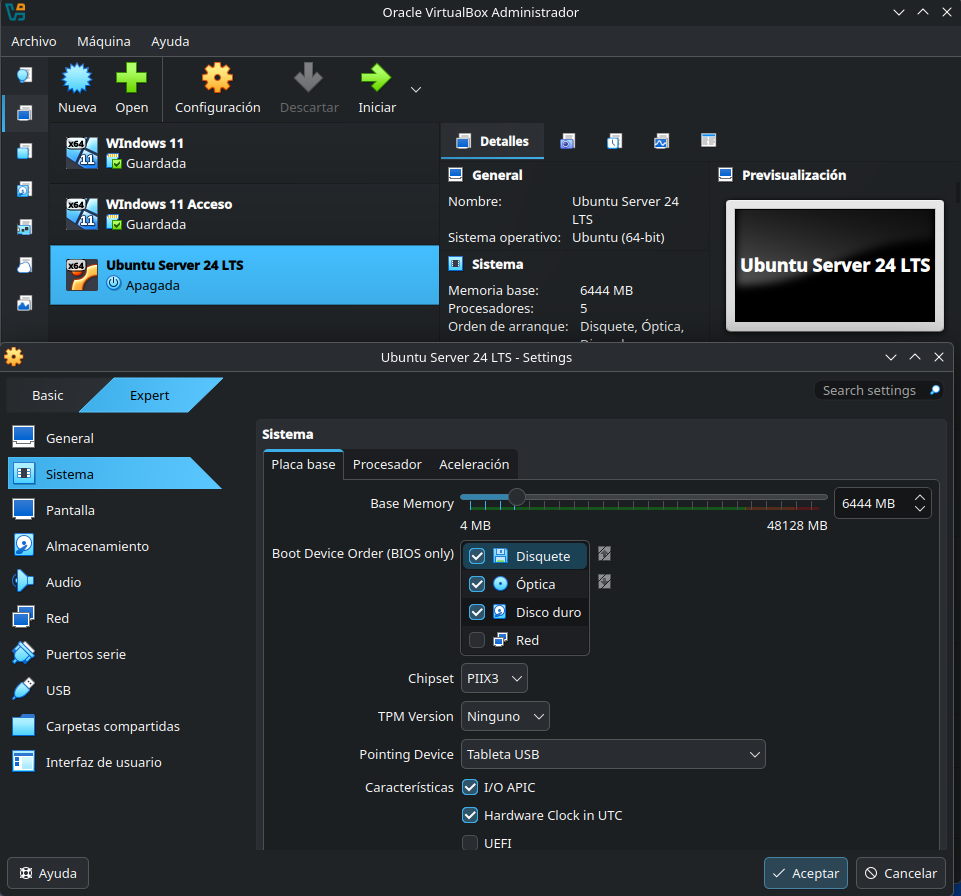
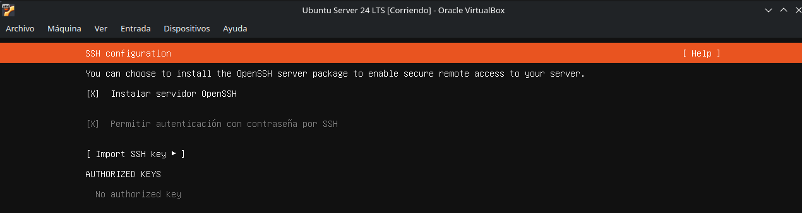
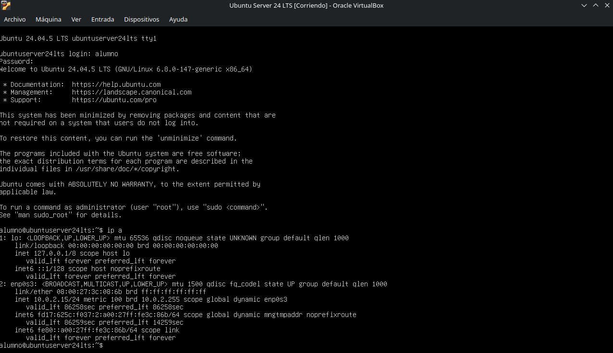

# Guía Detallada Paso a Paso y Memoria de Práctica: Instalación de Odoo 17 sobre Ubuntu Server 24 LTS

**Módulo:** UT03. Instalación y Configuración de Sistemas ERP-CRM  
**Profesor:** Enrique Nogales 
**Instituto:** IES Alonso de Avellaneda  
**Alumno(s):** Rubén Barrado Pastor  
**Curso:** 1º DAM  
**Fecha:** 23/10/2026  

---

## 📌 Introducción y Propósito de este Documento

Esta guía contiene la totalidad de los pasos necesarios, detallados comando por comando, para completar con éxito la **Práctica 1**. Además, está estructurada para servir de plantilla de la memoria final: en cada sección se incluye un **párrafo específico de captura** indicando exactamente qué debe aparecer en pantalla, qué elementos resaltar y el hueco para adjuntar la imagen.

---

## 📑 Índice de Contenidos

1. [Apartado 1: Instalación de Ubuntu Server 24 LTS en VirtualBox](#apartado-1-instalación-de-ubuntu-server-24-lts-en-virtualbox)
2. [Apartado 2: Comprobación y Obtención de la Dirección IP](#apartado-2-comprobación-y-obtención-de-la-dirección-ip)
3. [Apartado 3: Instalación de Máquina Virtual Windows](#apartado-3-instalación-de-máquina-virtual-windows)
4. [Apartado 4: Conexión SSH al Servidor Ubuntu desde Windows](#apartado-4-conexión-ssh-al-servidor-ubuntu-desde-windows)
5. [Apartado 5: Instalación del ERP Odoo 17 desde el Código Fuente](#apartado-5-instalación-del-erp-odoo-17-desde-el-código-fuente)
   - [5.A. Creación del usuario del sistema `odoo`](#5a-creación-del-usuario-del-sistema-odoo)
   - [5.B. Comprobación de Git y clonación del repositorio](#5b-comprobación-de-git-y-clonación-del-repositorio)
   - [5.C. Verificación de Python 3 y gestor pip](#5c-verificación-de-python-3-y-gestor-pip)
   - [5.D. Instalación y configuración de PostgreSQL](#5d-instalación-y-configuración-de-postgresql)
   - [5.E. Instalación de dependencias del sistema (`debinstall.sh`)](#5e-instalación-de-dependencias-del-sistema-debinstallsh)
   - [5.F. Primera ejecución de Odoo y configuración inicial vía Web](#5f-primera-ejecución-de-odoo-y-configuración-inicial-vía-web)
   - [5.G. Instalación de wkhtmltopdf y verificación de informes PDF](#5g-instalación-de-wkhtmltopdf-y-verificación-de-informes-pdf)
   - [5.H. Creación y ajuste del archivo de configuración `odoo-server.conf`](#5h-creación-y-ajuste-del-archivo-de-configuración-odoo-serverconf)
   - [5.I. Configuración de Odoo como servicio del sistema (`systemd`)](#5i-configuración-de-odoo-como-servicio-del-sistema-systemd)
6. [Apartado 6: Acceso a la Base de Datos vía Terminal (`psql`)](#apartado-6-acceso-a-la-base-de-datos-vía-terminal-psql)
7. [Apartado 7: Acceso a la Base de Datos vía Cliente Gráfico (`pgAdmin`)](#apartado-7-acceso-a-la-base-de-datos-vía-cliente-gráfico-pgadmin)
   - [7.1. Configuración de PostgreSQL para admitir conexiones remotas](#71-configuración-de-postgresql-para-admitir-conexiones-remotas)
   - [7.2. Conexión 1: Superusuario `postgres`](#72-conexión-1-superusuario-postgres)
   - [7.3. Conexión 2: Usuario específico `odoo`](#73-conexión-2-usuario-específico-odoo)
8. [Checklist Final de Entrega](#checklist-final-de-entrega)

---

## Apartado 1: Instalación de Ubuntu Server 24 LTS en VirtualBox

### Pasos detallados a seguir:

1. **Creación de la máquina virtual en Oracle VirtualBox:**
   - Abrir VirtualBox y pulsar en **Nueva**.
   - **Nombre:** `Ubuntu Server 24 LTS`.
   - **Tipo:** Linux / **Versión:** Ubuntu (64-bit).
   - **Memoria RAM:** Asignar **2048 MB** (2 GB).
   - **Procesador:** Asignar **2 CPUs**.
   - **Disco virtual:** Crear un disco virtual formato VDI de **30 GB** con tamaño de reserva dinámica.
   - Guardar la creación.

2. **Configuración de Red (Imprescindible):**
   - Seleccionar la máquina > **Configuración** > sección **Red**.
   - En **Adaptador 1**: cambiar de *NAT* a **Adaptador puente** (Bridged Adapter).
   - Seleccionar la tarjeta de red activa del equipo físico (Wi-Fi o Ethernet).
   - En *Avanzadas*, modo promiscuo: permitir todo o denegar (por defecto es suficiente).

> 📸 **[CAPTURA 1: CONFIGURACIÓN HARDWARE Y RED EN VIRTUALBOX]**  
> * **Qué debe verse:** La ventana de configuración de VirtualBox abierta, mostrando la sección **Sistema** (con 2048 MB de RAM y 2 CPUs) o la sección **Red** (con el "Adaptador puente" seleccionado).  
> * **Propósito:** Demostrar que se han respetado con precisión los requisitos técnicos del hardware asignado a la máquina virtual.  
> 
> 

3. **Instalación del sistema operativo:**
   - Iniciar la máquina virtual y cargar la imagen ISO de **Ubuntu Server 24.04 LTS**.
   - Seguir el asistente de instalación:
     - Idioma del instalador: Español o Inglés.
     - Disposición de teclado: *Spanish* (Español).
     - Tipo de instalación: Ubuntu Server (predeterminada / minificada).
     - Red (IPv4): Comprobar que toma IP por **DHCP** automáticamente.
     - Proxy y Mirror: Dejar por defecto y pulsar Continuar.
     - Configuración de almacenamiento: Usar todo el disco (30 GB) sin LVM cifrado.
     - **Perfil de usuario y máquina:**
       - *Su nombre:* `alumno`
       - *Nombre del servidor:* `Ubuntu Server 24 LTS`
       - *Nombre de usuario:* `alumno`
       - *Contraseña:* `alumno` (confirmar con `alumno`)
     - **Servidor SSH:** Marcar obligatoriamente la casilla **Instalar servidor OpenSSH** (Install OpenSSH server).
     - Paquetes Snap/Servicios destacados: **NO marcar ningún otro servicio** (ni Docker, ni microk8s, ni Nextcloud, etc.).
   - Esperar a que finalice la instalación, seleccionar *Reiniciar ahora* y desmontar la ISO cuando lo solicite.

> 📸 **[CAPTURA 2: ASISTENTE DE INSTALACIÓN - SELECCIÓN OPENSSH]**  
> * **Qué debe verse:** La pantalla del instalador de Ubuntu Server en el paso de "SSH Configuration" donde se vea claramente marcada la opción `[X] Install OpenSSH server` con el nombre de usuario `alumno`.  
> * **Propósito:** Acreditar que se activó el servicio SSH oficial durante el despliegue del sistema sin añadir servicios extras innecesarios.  
> 
> 

---

## Apartado 2: Comprobación y Obtención de la Dirección IP

### Pasos detallados a seguir:

1. Tras reiniciar, identificarse en la consola tty de Ubuntu Server con:
   - **Login:** `alumno`
   - **Password:** `alumno`
2. Averiguar la dirección IP asignada a la tarjeta de red ejecutando:
   ```bash
   ip a
   ```
   *(También se puede usar `ip -br a` para una vista abreviada).*
3. Localizar la interfaz de red (habitualmente llamada `enp0s3`). Buscar el valor que aparece junto a `inet` (por ejemplo: `192.168.1.XX` o `10.X.X.X`).
4. **Anotar esta dirección IP**, ya que será la que utilizaremos durante el resto de la práctica para SSH, conexión web a Odoo y conexión a PostgreSQL desde Windows.

> 📸 **[CAPTURA 3: COMPROBACIÓN DE LA IP MEDIANTE `ip a`]**  
> * **Qué debe verse:** La consola de Ubuntu Server con el usuario `alumno@Ubuntu Server 24 LTS:~$`, habiendo ejecutado el comando `ip a` o `ip -br a`, donde se visualice con claridad la dirección IP asignada a la interfaz `enp0s3` junto al rango de máscara `/24`.  
> * **Propósito:** Dejar constancia formal de la IP de la máquina para auditar que las conexiones posteriores apunten a este host.  
> 
> 

---

## Apartado 3: Instalación de Máquina Virtual Windows

### Pasos detallados a seguir:

1. Si no se dispone ya de una máquina virtual Windows 10/11:
   - Descargar la imagen ISO facilitada por el instituto desde el NAS:  
     `http://10.1.0.100/ISOs/SSOO/es_windows_10_enterprise_ltsc_2019_x64_vl.iso`  
     *(o utilizar la máquina Windows existente en el taller/laboratorio según las directrices del profesor).*
2. En VirtualBox:
   - Crear una VM con al menos **2048 - 4096 MB de RAM**, **2 CPUs** y adaptador de red en **Adaptador puente** (para que esté en el mismo rango de red que la máquina Ubuntu Server).
3. Completar la instalación básica de Windows y verificar conectividad básica haciendo ping a la máquina Ubuntu:
   ```cmd
   ping <IP_Servidor_Ubuntu>
   ```

> 📸 **[CAPTURA 4: ESCRITORIO DE WINDOWS Y PING HACIA UBUNTU]**  
> * **Qué debe verse:** El escritorio de la máquina virtual de Windows 10/11 con una ventana de CMD abierta en la que se ejecute exitosamente un `ping <IP_Ubuntu>` con 0% de paquetes perdidos.  
> * **Propósito:** Probar que ambas máquinas virtuales están en el mismo segmento de red local gracias al adaptador puente y pueden comunicarse sin bloqueos.  
> 
> 

---

## Apartado 4: Conexión SSH al Servidor Ubuntu desde Windows

Debemos realizar la conexión remota desde la máquina Windows al servidor Ubuntu mediante dos métodos diferentes:

### 4.1. Conexión Vía Cliente PuTTY

1. Desde Windows, descargar el ejecutable de **PuTTY** (desde su sitio web oficial `putty.org`).
2. Abrir PuTTY e introducir los datos:
   - **Host Name (or IP address):** `<IP_Servidor_Ubuntu>`
   - **Port:** `22`
   - **Connection type:** `SSH`
3. Pulsar en **Open**. Si sale un aviso sobre la clave del host (*PuTTY Security Alert*), hacer clic en **Accept**.
4. En el terminal que se despliega:
   - Introducir `login as: alumno`.
   - Escribir la contraseña: `alumno`.

> 📸 **[CAPTURA 5: CONEXIÓN SSH EXITOSA MEDIANTE PUTTY]**  
> * **Qué debe verse:** Dos ventanas: la ventana principal de configuración de PuTTY con la IP colocada, y al lado la ventana de la terminal de PuTTY con la sesión iniciada mostrando el prompt verde `alumno@ubuntu-server:~$`.  
> * **Propósito:** Evidenciar el acceso por SSH utilizando el cliente gráfico PuTTY según las instrucciones.  
> 
> 

### 4.2. Conexión Vía Terminal (CMD / Símbolo del Sistema)

1. En Windows, presionar `Win + R`, escribir `cmd` y pulsar `Enter`.
2. Ejecutar el comando nativo de SSH:
   ```cmd
   ssh alumno@<IP_Servidor_Ubuntu>
   ```
3. Si pregunta `Are you sure you want to continue connecting (yes/no/[fingerprint])?`, escribir `yes` y pulsar `Enter`.
4. Escribir la contraseña `alumno` y confirmar el acceso al sistema.

> 📸 **[CAPTURA 6: CONEXIÓN SSH EXITOSA DESDE CMD DE WINDOWS]**  
> * **Qué debe verse:** La ventana del Símbolo del Sistema (CMD) de Windows con el comando `ssh alumno@<IP>` ejecutado y la cabecera de bienvenida de Ubuntu Server 24 LTS, dejando ver el prompt `alumno@Ubuntu Server 24 LTS:~$`.  
> * **Propósito:** Demostrar el dominio del cliente de línea de comandos OpenSSH de Windows.  
> 
> 

---

## Apartado 5: Instalación del ERP Odoo 17 desde el Código Fuente

Todas las operaciones se pueden realizar cómodamente desde la sesión SSH de Windows o directamente en la consola de Ubuntu.

---

### 5.A. Creación del usuario del sistema `odoo`

Por seguridad y buenas prácticas, Odoo debe ejecutarse bajo un usuario de sistema propio y sin privilegios de administración directa.

1. Estando logados como `alumno`, crear el usuario `odoo` con su carpeta home:
   ```bash
   sudo adduser odoo
   ```
2. El sistema solicitará la contraseña: escribir **`odoo`** y repetirla **`odoo`**.
3. El resto de datos personales (Full Name, Room Number, etc.) se pueden dejar en blanco pulsando `Enter`. Al final pulsar `Y` para confirmar.

> 📸 **[CAPTURA 7: CREACIÓN DEL USUARIO `odoo` EN EL SISTEMA]**  
> * **Qué debe verse:** La terminal ejecutando `sudo adduser odoo`, la asignación de contraseña `odoo` y la confirmación final de creación del home `/home/odoo`.  
> * **Propósito:** Validar la creación del usuario del sistema con su correspondiente directorio de trabajo.  
> 
> 

---

### 5.B. Comprobación de Git y clonación del repositorio

1. Comprobar si Git está instalado:
   ```bash
   git --version
   ```
   *Si no estuviera instalado, instalarlo con:*
   ```bash
   sudo apt update && sudo apt install -y git
   ```
2. Iniciar sesión como el usuario `odoo`:
   ```bash
   su - odoo
   ```
   *(Pedirá la contraseña `odoo`). Comprobar que el prompt cambia a `odoo@...` y que estamos en `/home/odoo` con `pwd`.*

3. Descargar el código fuente de Odoo 17 desde GitHub:
   ```bash
   git clone https://github.com/Odoo/odoo.git --depth 1 --branch 17.0 --single-branch
   ```
   > **Nota didáctica:** La opción `--branch 17.0 --single-branch` descarga exclusivamente la versión 17 y `--depth 1` descarga únicamente el último commit, reduciendo enormemente el peso de la descarga de gigabytes a solo unos cientos de megabytes.

4. Verificar que se ha descargado el directorio `odoo` listando su contenido:
   ```bash
   ls -la /home/odoo/odoo
   ```

> 📸 **[CAPTURA 8: DESCARGA DEL CÓDIGO FUENTE CON GIT]**  
> * **Qué debe verse:** El usuario `odoo` ejecutando el comando `git clone ... --branch 17.0` y el progreso de descarga al 100%, seguido del comando `ls -la odoo` donde se vean carpetas como `addons/`, `odoo-bin`, `setup/`, etc.  
> * **Propósito:** Demostrar que el código fuente oficial de la versión 17.0 fue clonado en la ruta correcta.  
> 
> 

---

### 5.C. Verificación de Python 3 y gestor pip

1. Volver a la cuenta `alumno` escribiendo:
   ```bash
   exit
   ```
2. Comprobar la versión instalada de Python (debe ser Python 3.10 o superior; Ubuntu 24.04 incorpora Python 3.12.x):
   ```bash
   python3 --version
   ```
3. Comprobar si `pip3` está instalado:
   ```bash
   pip3 --version
   ```
4. Si no está instalado, instalarlo como administrador (`alumno`):
   ```bash
   sudo apt update
   sudo apt install -y python3-pip python3-dev
   ```

> 📸 **[CAPTURA 9: VERIFICACIÓN DE VERSIONES DE PYTHON Y PIP]**  
> * **Qué debe verse:** La terminal ejecutando `python3 --version` (mostrando Python 3.12.x) y `pip3 --version`.  
> * **Propósito:** Verificar el cumplimiento de los prerrequisitos de entorno de ejecución para Odoo 17.  
> 
> 

---

### 5.D. Instalación y configuración de PostgreSQL

1. Instalar el gestor de bases de datos PostgreSQL y su cliente:
   ```bash
   sudo apt install -y postgresql postgresql-client
   ```
2. Comprobar que el servicio está activo:
   ```bash
   sudo systemctl status postgresql
   ```
3. Odoo exige no utilizar el superusuario `postgres` para el funcionamiento de la aplicación. Creamos el usuario de base de datos `odoo` con privilegios de creación de base de datos (`--createdb`):
   ```bash
   sudo su - postgres
   createuser --createdb --pwprompt odoo
   ```
   - El sistema preguntará: `Enter password for new role:`. Escribir: **`odoo`**.
   - Preguntará: `Enter it again:`. Volver a escribir: **`odoo`**.
   - Salir de la sesión de postgres:
     ```bash
     exit
     ```

> 💡 **Resolución de problemas si falla `createuser` con error de socket:**  
> Si se muestra un error de conexión hacia el socket Unix de PostgreSQL, comprobar y arrancar el cluster:  
> ```bash
> pg_lsclusters
> sudo su postgres
> pg_ctlcluster 16 main start
> exit
> ```  
> Y repetir el comando `createuser`.

> 📸 **[CAPTURA 10: CREACIÓN DEL USUARIO DE BASE DE DATOS `odoo`]**  
> * **Qué debe verse:** El cambio al usuario `postgres` (`sudo su - postgres`), la ejecución de `createuser --createdb --pwprompt odoo` solicitando la contraseña, y el retorno limpio a la terminal.  
> * **Propósito:** Acreditar que el rol de base de datos para Odoo fue configurado con los permisos requeridos (`createdb`).  
> 
> 

---

### 5.E. Instalación de dependencias del sistema (`debinstall.sh`)

Odoo incluye un script de instalación que resuelve todas las bibliotecas de sistema C/C++, fuentes y módulos necesarios en distribuciones basadas en Debian/Ubuntu.

1. Como usuario administrador `alumno`, ejecutar:
   ```bash
   sudo /home/odoo/odoo/setup/debinstall.sh
   ```
2. Esperar a que el script actualice repositorios e instale todos los paquetes del sistema necesarios (como `libxml2-dev`, `libxslt1-dev`, `libldap2-dev`, `libsasl2-dev`, etc.).

> 📸 **[CAPTURA 11: EJECUCIÓN DE `debinstall.sh`]**  
> * **Qué debe verse:** La salida del script `debinstall.sh` terminando de procesar e instalar las dependencias de paquetes Debian/Ubuntu sin errores fatales.  
> * **Propósito:** Justificar la instalación integral de los paquetes base requeridos por Odoo.  
> 
> 

---

### 5.F. Primera ejecución de Odoo y configuración inicial vía Web

1. Iniciar sesión como usuario `odoo`:
   ```bash
   su - odoo
   cd /home/odoo/odoo
   ```
2. Arrancar Odoo de forma manual especificando la ruta de los módulos estándar:
   ```bash
   python3 odoo-bin --addons-path=addons
   ```
3. En la terminal se observarán los logs de inicio de Odoo indicando que el servidor HTTP está escuchando en `0.0.0.0:8069`.

> 📸 **[CAPTURA 12: LOGS DE LA PRIMERA EJECUCIÓN DE ODOO EN CONSOLA]**  
> * **Qué debe verse:** La terminal con el comando `python3 odoo-bin --addons-path=addons` en ejecución y las líneas de log finales indicando `odoo.service.server: HTTP service (werkzeug) running on 0.0.0.0:8069`.  
> * **Propósito:** Demostrar que el servidor Odoo levanta correctamente por primera vez.  
> 
> 

4. **Acceso al Asistente Web de Configuración:**
   - Desde la máquina Windows (o desde el navegador del equipo anfitrión), abrir un navegador y acceder a:  
     `http://<IP_Servidor_Ubuntu>:8069`
   - Aparecerá la pantalla del asistente de creación de base de datos (*Database Creation Form*).
5. **Rellenar los campos solicitados:**
   - **Master Password:** Mantener la generada automáticamente por el sistema (¡copiarla y guardarla!).
   - **Database Name:** `test`
   - **Email:** `admin`
   - **Password:** `admin`
   - **Phone Number:** Dejar vacío
   - **Language:** `Spanish (ES) / Español (ES)`
   - **Country:** `Spain`
   - **Demo data:** **Marcar la casilla de verificación** (para tener datos de ejemplo en las pruebas).
   - Pulsar sobre el botón **Create database**.
   *(El proceso tardará entre 1 y 3 minutos mientras Odoo crea la estructura en PostgreSQL).*

> 📸 **[CAPTURA 13: FORMULARIO DE CREACIÓN DE BASE DE DATOS `test`]**  
> * **Qué debe verse:** El navegador web en `http://<IP_Ubuntu>:8069` con el formulario relleno exactamente con los valores requeridos (Base de datos: `test`, Email: `admin`, Demo data marcada).  
> * **Propósito:** Comprobar la parametrización exacta exigida por el enunciado antes de crear la BD.  
> 
> 

6. Al terminar la creación, Odoo redirigirá al catálogo principal de aplicaciones. Iniciar sesión si lo solicita con `admin` / `admin`.

> 📸 **[CAPTURA 14: INTERFAZ WEB DE ODOO TRAS EL PRIMER LOGIN]**  
> * **Qué debe verse:** La pantalla principal de Odoo 17 en el navegador web con el menú de aplicaciones disponibles (Ventas, CRM, Facturación, Inventario, etc.) y en la esquina superior derecha el usuario `admin`.  
> * **Propósito:** Confirmar que Odoo está completamente operativo y con la sesión iniciada.  
> 
> 

7. En la terminal donde dejamos ejecutando Odoo, pulsar **`Ctrl + C`** para detener temporalmente el proceso y continuar con los siguientes pasos.

---

### 5.G. Instalación de wkhtmltopdf y verificación de informes PDF

Odoo requiere el motor `wkhtmltopdf` para renderizar informes, presupuestos y facturas en formato PDF.

1. Volver al usuario administrador `alumno`:
   ```bash
   exit
   ```
2. Descargar la versión 0.12.6.1-2 compatible con Ubuntu amd64:
   ```bash
   wget https://github.com/wkhtmltopdf/packaging/releases/download/0.12.6.1-2/wkhtmltox_0.12.6.1-2.jammy_amd64.deb
   ```
3. Instalar el paquete `.deb` resolviendo automáticamente sus dependencias con `apt`:
   ```bash
   sudo apt install -y ./wkhtmltox_0.12.6.1-2.jammy_amd64.deb
   ```
4. Comprobar que está disponible en el sistema:
   ```bash
   wkhtmltopdf --version
   ```
5. Volver a arrancar Odoo para hacer la prueba:
   ```bash
   su - odoo
   cd /home/odoo/odoo
   python3 odoo-bin --addons-path=addons
   ```
6. **Comprobación en la interfaz gráfica:**
   - En el navegador, ir al catálogo de Aplicaciones e instalar el módulo **Ventas** (Sales).
   - Acceder al menú **Ventas** > **Presupuestos** (o Cotizaciones).
   - Abrir cualquiera de los presupuestos cargados por los datos de demostración (ejemplo: `S00001`).
   - Pulsar sobre el botón **Vista previa del cliente** (Customer Preview) o pulsar en la rueda de configuración / icono de impresora > **Presupuesto / Pedido** para generar y descargar el PDF.

> 📸 **[CAPTURA 15: GENERACIÓN DE FACTURA / PRESUPUESTO EN PDF CON WKHTMLTOPDF]**  
> * **Qué debe verse:** El navegador mostrando el documento PDF generado por Odoo (presupuesto con logotipo, líneas de producto, importes e IVA) o el visor de PDF integrado confirmando que `wkhtmltopdf` trabaja correctamente sin errores.  
> * **Propósito:** Demostrar que el motor de generación de informes impresos y facturas en PDF está plenamente operativo.  
> 
> 

7. Detener nuevamente Odoo en la terminal con **`Ctrl + C`**.

---

### 5.H. Creación y ajuste del archivo de configuración `odoo-server.conf`

Al arrancar Odoo por primera vez y crear la base de datos, el sistema genera automáticamente un fichero oculto llamado `.odoorc` en la carpeta home del usuario `odoo`.

1. Como usuario `odoo` (si estamos como `alumno`, hacer `su - odoo`), situarse en la raíz del usuario:
   ```bash
   cd /home/odoo
   ls -la
   ```
2. Crear un directorio llamado `conf` y copiar el fichero oculto con el nuevo nombre:
   ```bash
   mkdir -p conf
   cp .odoorc conf/odoo-server.conf
   ```
3. Editar el fichero con `nano`:
   ```bash
   nano conf/odoo-server.conf
   ```
4. Mantener la directiva `admin_passwd` que ya viene generada intacta, y añadir o ajustar las siguientes opciones en el bloque `[options]`:
   ```ini
   addons_path = /home/odoo/odoo/odoo/addons,/home/odoo/odoo/addons
   db_host = 127.0.0.1
   db_port = 5432
   db_user = odoo
   db_password = odoo
   ```
   *(Guardar con `Ctrl + O`, confirmar con `Enter` y salir con `Ctrl + X`).*

5. Probar a arrancar Odoo indicando explícitamente el archivo de configuración con el parámetro `-c`:
   ```bash
   cd /home/odoo/odoo
   python3 odoo-bin -c /home/odoo/conf/odoo-server.conf
   ```
6. Verificar que Odoo arranca normalmente sin quejarse de la conexión a la base de datos. Detenerlo con `Ctrl + C`.

> 📸 **[CAPTURA 16: CONTENIDO DEL FICHERO `odoo-server.conf`]**  
> * **Qué debe verse:** El editor `nano` mostrando el contenido del archivo `/home/odoo/conf/odoo-server.conf` donde se vean claramente las líneas de `addons_path`, `db_host = 127.0.0.1`, `db_port = 5432`, `db_user = odoo` y `db_password = odoo`.  
> * **Propósito:** Demostrar que la configuración persistente del servidor y la autenticación con la BD están correctamente establecidas.  
> 
> 

---

### 5.I. Configuración de Odoo como servicio del sistema (`systemd`)

Para que Odoo se ejecute en segundo plano, se inicie automáticamente con el sistema y guarde registros estructurados en un log, creamos una unidad de servicio `systemd`.

1. Salir a la cuenta con privilegios `alumno`:
   ```bash
   exit
   ```
2. Crear el fichero del servicio con `sudo`:
   ```bash
   sudo nano /etc/systemd/system/odoo.service
   ```
3. Pegar el siguiente bloque de configuración:
   ```ini
   [Unit]
   Description=Odoo Open Source ERP and CRM
   After=network.target

   [Service]
   Type=simple
   User=odoo
   Group=odoo
   ExecStart=/usr/bin/python3 /home/odoo/odoo/odoo-bin -c /home/odoo/conf/odoo-server.conf --logfile /home/odoo/odoo.log --dev=all
   KillMode=mixed

   [Install]
   WantedBy=multi-user.target
   ```
   *(Guardar con `Ctrl + O`, `Enter` y salir con `Ctrl + X`).*

4. Notificar a systemd para que cargue la nueva unidad:
   ```bash
   sudo systemctl daemon-reload
   ```
5. Habilitar el servicio para que arranque en cada inicio de la máquina:
   ```bash
   sudo systemctl enable odoo.service
   ```
6. Arrancar el servicio:
   ```bash
   sudo systemctl start odoo.service
   ```
7. Comprobar el estado del servicio:
   ```bash
   sudo systemctl status odoo.service
   ```
8. Realizar las pruebas de parada y reinicio solicitadas:
   ```bash
   sudo systemctl restart odoo.service
   sudo systemctl stop odoo.service
   sudo systemctl start odoo.service
   ```
9. Verificar que se está escribiendo en el archivo de registro:
   ```bash
   tail -n 25 /home/odoo/odoo.log
   ```

> 📸 **[CAPTURA 17: ESTADO ACTIVO DEL SERVICIO `odoo.service` EN SYSTEMD]**  
> * **Qué debe verse:** La salida del comando `sudo systemctl status odoo.service` mostrando el estado en verde `active (running)`, el PID del proceso y la ruta del ejecutable.  
> * **Propósito:** Demostrar la gestión correcta del ciclo de vida de Odoo a través del demonio systemd.  
> 
> 

---

## Apartado 6: Acceso a la Base de Datos vía Terminal (`psql`)

### Pasos detallados a seguir:

1. Como usuario `alumno`, asignar una contraseña de sistema al usuario de Linux `postgres` para permitir iniciar sesión con él:
   ```bash
   sudo passwd postgres
   ```
   - Introducir como nueva contraseña: `postgres` (confirmar con `postgres`).

2. Iniciar sesión como el usuario de sistema `postgres`:
   ```bash
   su - postgres
   ```
3. Acceder a la interfaz interactiva de PostgreSQL:
   ```bash
   psql
   ```
4. Comprobar los roles existentes en el motor:
   ```sql
   \du
   ```
   *(Deberán aparecer los roles `postgres` y `odoo`, este último con el atributo "Create DB").*

5. Listar las bases de datos creadas:
   ```sql
   \l
   ```
   *(Deberá aparecer la base de datos `test` con propietario `odoo`).*

6. Conectarse a la base de datos de Odoo:
   ```sql
   \connect test
   ```
7. Listar las tablas generadas por Odoo:
   ```sql
   \dt
   ```
8. Salir del cliente interactivo:
   ```sql
   \q
   ```
9. Regresar al usuario `alumno`:
   ```bash
   exit
   ```

> 📸 **[CAPTURA 18: CONSULTA DE ROLES Y BASES DE DATOS EN `psql`]**  
> * **Qué debe verse:** La consola interactiva de `psql` mostrando la ejecución del comando `\du` (con los roles `odoo` y `postgres`) y el comando `\l` listando la base de datos `test`.  
> * **Propósito:** Demostrar la interacción administrativa directa con PostgreSQL desde la línea de comandos.  
> 
> 

---

## Apartado 7: Acceso a la Base de Datos vía Cliente Gráfico (`pgAdmin`)

Realizaremos la administración remota desde la máquina virtual con Windows conectándonos al PostgreSQL de Ubuntu.

---

### 7.1. Configuración de PostgreSQL para admitir conexiones remotas

Por defecto, PostgreSQL sólo escucha en la interfaz local (`localhost` / `127.0.0.1`). Debemos habilitar el acceso a través de la red local.

1. **Asignar contraseña al superusuario en el propio motor de base de datos:**
   - Desde Ubuntu, ejecutar:
     ```bash
     sudo -u postgres psql -c "ALTER ROLE postgres PASSWORD 'postgres';"
     ```
2. **Modificar la escucha de interfaces en `postgresql.conf`:**
   - Editar con `sudo`:
     ```bash
     sudo nano /etc/postgresql/16/main/postgresql.conf
     ```
   - Presionar `Ctrl + W` para buscar: `listen_addresses`.
   - Comentar la línea existente o modificarla para que quede exactamente así:
     ```ini
     listen_addresses = '*'
     ```
   - Guardar con `Ctrl + O` y salir con `Ctrl + X`.

3. **Permitir la autenticación externa en `pg_hba.conf`:**
   - Editar con `sudo`:
     ```bash
     sudo nano /etc/postgresql/16/main/pg_hba.conf
     ```
   - Bajar hasta la sección `# IPv4 local connections:`. Justo debajo de la línea de `127.0.0.1/32`, añadir la siguiente línea:
     ```text
     host    all             all             all                     scram-sha-256
     ```
     *(Si la versión o cliente presenta problemas de cifrado, se puede usar `md5`, aunque `scram-sha-256` es el estándar en PostgreSQL 16).*
   - Guardar y salir.

4. **Reiniciar el servicio de base de datos:**
   ```bash
   sudo systemctl restart postgresql.service
   ```
5. *(Opcional / Comprobación)* Verificar que el puerto 5432 está escuchando en todas las interfaces:
   ```bash
   sudo ss -tulpn | grep 5432
   ```

> 📸 **[CAPTURA 19: CONFIGURACIÓN DE `postgresql.conf` Y `pg_hba.conf`]**  
> * **Qué debe verse:** El archivo `pg_hba.conf` en nano con la línea `host all all all scram-sha-256` añadida, junto con la salida de `systemctl restart postgresql.service`.  
> * **Propósito:** Demostrar la apertura segura de conexiones remotas para clientes de administración externa.  
> 
> 

---

### 7.2. Conexión 1: Superusuario `postgres`

1. En la máquina Windows, descargar e instalar **pgAdmin 4** desde su sitio web oficial (`pgadmin.org`) con las opciones predeterminadas.
2. Abrir pgAdmin 4.
3. En el panel izquierdo (*Object Explorer*), hacer clic derecho en **Servers** > **Register** > **Server...** (o botón *Add New Server* del panel central).
4. Configurar la pestaña **General**:
   - **Name:** `Ubuntu Server - Superusuario Postgres`
5. Configurar la pestaña **Connection**:
   - **Host name/address:** `<IP_Servidor_Ubuntu>` (Ej: `192.168.1.XX`)
   - **Port:** `5432`
   - **Maintenance database:** `postgres`
   - **Username:** `postgres`
   - **Password:** `postgres`
   - Marcar la casilla **Save password**.
6. Hacer clic en **Save**.
7. En el árbol de objetos de la izquierda:
   - Desplegar `Servers` > `Ubuntu Server - Superusuario Postgres` > `Databases` > `test` > `Schemas` > `public` > `Tables`.
   - Confirmar que aparecen las **más de 360 tablas** (aproximadamente 366) creadas por los módulos de Odoo.

> 📸 **[CAPTURA 20: CONEXIÓN EN PGADMIN CON SUPERUSUARIO `postgres`]**  
> * **Qué debe verse:** La ventana completa de pgAdmin 4 en Windows, mostrando en el árbol izquierdo el servidor conectado, la base de datos `test` desplegada y la lista numerosa de tablas (`res_partner`, `sale_order`, `ir_model`, etc.).  
> * **Propósito:** Probar la conexión gráfica exitosa como superusuario y la existencia de las tablas del ERP.  
> 
> 

---

### 7.3. Conexión 2: Usuario específico `odoo`

Para no comprometer la seguridad del servidor utilizando siempre las credenciales del superusuario, creamos una segunda entrada de conexión específica para el usuario de trabajo `odoo`.

1. En pgAdmin 4, volver a hacer clic derecho en **Servers** > **Register** > **Server...**
2. Configurar la pestaña **General**:
   - **Name:** `Ubuntu Server - Usuario Odoo`
3. Configurar la pestaña **Connection**:
   - **Host name/address:** `<IP_Servidor_Ubuntu>`
   - **Port:** `5432`
   - **Maintenance database:** `test` (o `postgres`)
   - **Username:** `odoo`
   - **Password:** `odoo`
   - Marcar la casilla **Save password**.
4. Hacer clic en **Save**.
5. Desplegar la conexión y comprobar que se tiene acceso a la base de datos `test` y a sus tablas correspondientes.

> 📸 **[CAPTURA 21: CONEXIÓN EN PGADMIN CON USUARIO `odoo`]**  
> * **Qué debe verse:** El panel de pgAdmin 4 mostrando ambos servidores registrados en la lista, con el servidor `Ubuntu Server - Usuario Odoo` conectado activamente y desplegando el esquema `public` de la base de datos `test`.  
> * **Propósito:** Demostrar las buenas prácticas de administración limitando el acceso mediante el usuario de la aplicación.  
> 
> 

---

## 📋 Checklist Final de Entrega

Antes de generar el documento PDF definitivo para subirlo al aula virtual, verificar que se dispone de:

- [ ] Portada con los datos de los integrantes del grupo (Nombre y Apellidos).
- [ ] Todas las explicaciones teóricas y comandos de cada paso incluidos.
- [ ] **Captura 1:** Configuración de VirtualBox (RAM, CPUs, Disco).
- [ ] **Captura 2:** Instalación de Ubuntu Server con OpenSSH marcado.
- [ ] **Captura 3:** Comando `ip a` con la dirección IP del servidor.
- [ ] **Captura 4:** Ping desde Windows hacia la IP de Ubuntu.
- [ ] **Captura 5:** Acceso SSH mediante PuTTY.
- [ ] **Captura 6:** Acceso SSH mediante CMD de Windows.
- [ ] **Captura 7:** Creación del usuario Linux `odoo`.
- [ ] **Captura 8:** Clonación con Git de la rama 17.0 de Odoo.
- [ ] **Captura 9:** Comprobación de versiones de Python 3 y pip.
- [ ] **Captura 10:** Creación del rol `odoo` en PostgreSQL (`createuser`).
- [ ] **Captura 11:** Salida del instalador `debinstall.sh`.
- [ ] **Captura 12:** Logs de la primera ejecución en terminal (`odoo-bin`).
- [ ] **Captura 13:** Asistente web completado con la base de datos `test` y datos demo.
- [ ] **Captura 14:** Pantalla del catálogo de aplicaciones de Odoo tras el login de `admin`.
- [ ] **Captura 15:** Informe o presupuesto generado en PDF con `wkhtmltopdf`.
- [ ] **Captura 16:** Archivo de configuración `/home/odoo/conf/odoo-server.conf`.
- [ ] **Captura 17:** Salida de `systemctl status odoo.service` activo.
- [ ] **Captura 18:** Acceso y comandos en terminal `psql` (`\du`, `\l`).
- [ ] **Captura 19:** Ajustes en `postgresql.conf` y `pg_hba.conf`.
- [ ] **Captura 20:** Conexión en pgAdmin con el usuario `postgres` y tablas de `test`.
- [ ] **Captura 21:** Conexión en pgAdmin con el usuario `odoo`.
- [ ] Documento exportado a formato **PDF** con el nombre según la convención del profesor.
